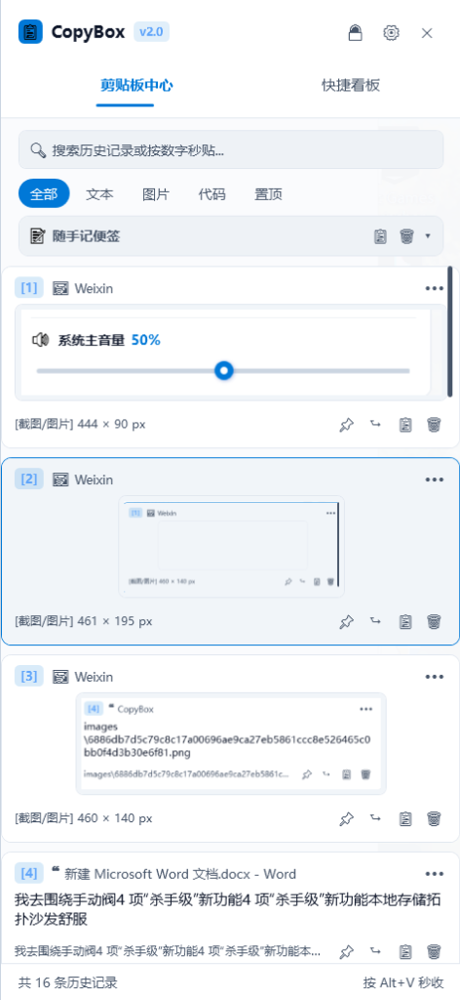
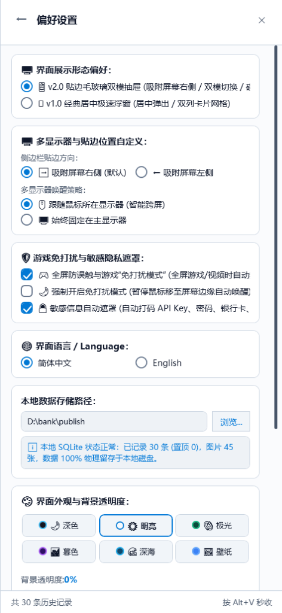

<div align="center">

# CopyBox 📦 v2.1

**面向 Windows 10 / 11 的现代化贴边毛玻璃效率抽屉 & 100% 纯本地离线隐私剪贴板管理器。**  
*A blazingly fast, privacy-first, 100% local clipboard manager & productivity drawer for Windows 10/11 built with .NET 8 & modern Fluent Design.*

[](https://dotnet.microsoft.com/)
[](https://microsoft.com/windows)
[](https://github.com/1Than499/CopyBox/releases)
[](LICENSE)
[](#)

[ **🆕 v2.1 更新内容** ](#-v21-版本更新说明-whats-new-in-v21) | [ **🇨🇳 简体中文** ](#-简体中文) | [ **🇺🇸 English** ](#-english)

</div>

---

## 🆕 v2.1 版本更新说明 (What's New in v2.1)

### 🛠️ 核心修复与体验进化
1. **🖱️ 贴边收起后屏幕右边缘悬停自动唤出**：
   - 新增毫秒级屏幕右边缘热区感应引擎。当侧边栏贴边隐藏后，只需将鼠标移至屏幕最右侧边缘即可丝滑滑出界面；未锁定（`🔓`）状态下鼠标移出面板区域后自动平滑收起。
2. **⚡ 彻底修复首次点击「设置」崩溃问题**：
   - 移除单文件打包环境下存在字体流寻址隐患的第三方 UI 依赖，重构为 100% 原生 WPF 矢量 Fluent 控件样式，并加固初始化生命周期保护锁，首次及任意时刻打开设置均零崩溃、秒级响应。
3. **📁 便携版本地数据存储路径默认与程序根目录一致**：
   - 绿色便携版默认将配置文件（`settings.json`）、本地 SQLite 数据库（`clipvault.db`）及图片/壁纸缓存直接保存在程序所在根目录，真正实现「整个文件夹拷入 U 盘或移动硬盘即插即用，数据随身走」。
4. **🔄 v1.0 居中浮窗与 v2.0 侧边栏双形态设置 100% 同源互通**：
   - 彻底统一两套界面形态下的全部设置项（6 大主题、自定义壁纸、背景透明度、本地存储路径与 SQLite 状态统计、关闭动作、双击卡片行为等），修改任意一项设置或迁移数据目录均在双形态间实时双向同步。
5. **🎨 「背景透明度」逻辑修正与 120FPS 满帧丝滑拖动**：
   - 修正透明度滑块语义：`0%` 代表完全不透明，向右滑动（`0% ~ 85%`）逐步增加背景通透度，且前景文字与图标始终保持 100% 锐利清晰；采用底层 DirectX 画刷 Alpha 通道原位更新与磁盘写入防抖技术，滑动调节全程零卡顿。
6. **🧩 快捷看板添加程序时默认自动提取程序原生图标**：
   - 在快捷看板添加应用程序（`.exe`）动作时，默认自动提取并高清渲染该程序的原生系统图标；同时保留自定义 Emoji 图标能力（填写 Emoji 则优先展示自定义 Emoji，留空则展示程序原生图标）。

---

<p align="center">
  
  
</p>
<p align="center">
  <em>左图：v2.0 剪贴板中心（历史卡片、随手记便签、分类药丸、快速秒贴） &nbsp;|&nbsp; 右图：v2.0 快捷看板（音乐播放控制、系统快捷、自定义动作、屏幕亮度/音量调节）</em>
</p>

<div align="center">

### 📥 绿色便携免安装版下载 (小白与普通用户推荐)
无需安装 Git，也不需要复杂的开发环境，解压即用，数据默认随程序根目录便携存储，不写系统注册表：

**🆕 最新 v2.1.0 版本下载：**  
[](https://github.com/1Than499/CopyBox/releases/download/v2.1.0/CopyBox-v2.1.0-Windows-x64-Portable.zip)  
[](https://github.com/1Than499/CopyBox/raw/main/publish/CopyBox-v2.1.exe)

**📦 历史 v2.0.0 版本归档：**  
[](https://github.com/1Than499/CopyBox/releases/download/v2.0.0/CopyBox-v2.0.0-Windows-x64-Portable.zip)  
[](https://github.com/1Than499/CopyBox/raw/main/publish/CopyBox-v2.0.exe)

*(更多版本请查阅右侧 [📦 GitHub Releases 发行版列表](https://github.com/1Than499/CopyBox/releases))*

</div>

---

# 🇨🇳 简体中文

## 🌟 为什么选择 CopyBox 2.0？

在日常使用 Windows 时，自带的剪贴板历史经常呼出迟缓、图片加载卡顿、缺少快速搜索和常用内容置顶功能；而市面上大多数第三方剪贴板工具不仅体积臃肿（基于 Electron 动辄占用几百兆内存），甚至强制捆绑云端同步，让密码、API Token、私信记录等极度敏感的数据面临泄露风险。

**CopyBox 2.0 破局而生**，它不仅是一个极速轻量的离线剪贴板，更进化为 Windows 桌面右侧优雅的 **多合一生产力抽屉**：
1. **绝对隐私，100% 纯本地离线**：不发起任何网络请求、不收集任何用户遥测，所有历史数据物理留存在用户本地磁盘；
2. **自由指定本地路径，零成本私有云同步**：支持将数据目录自由绑定到你的 **OneDrive / Dropbox / 坚果云** 目录，无需依赖第三方云服务即可安全多端同步；
3. **全新贴边毛玻璃抽屉与经典居中双模无缝切换**：屏幕右侧边缘亚克力智能抽屉（支持失焦即收与图钉常驻），也可在设置中随时切换回经典居中卡片面板；
4. **双重视图架构**：集成 `[ 📋 剪贴板中心 ]` 与 `[ ⚡ 快捷看板 ]` 药丸切换，办公提效与系统控制触手可及；
5. **极速性能与刀锋级画质**：原生 .NET 8 + WPF 渲染引擎，冷启动飞快，常驻内存极低，毫秒级响应。

---

## ✨ 核心特性一览

### 1. 🗂️ 剪贴板中心 (Clipboard Center)
- **智能内容格式化呈现**：
  - **代码片段**：自动识别 JSON、各类编程语言，采用代码高亮卡片排版；
  - **图片与截图**：自动解析图片分辨率与尺寸（如 `444 × 90 px`），提供圆角自适应缩略图；
  - **多行文本**：优雅段落排版，智能标注复制来源应用（如 Weixin、Word、Chrome 等）；
- **数字键极限秒贴 (`1~9` / `Alt+1~9`)**：无需移动鼠标，按下对应序号即可瞬间将内容粘入目标光标处；
- **智能分类药丸**：提供 `全部`、`文本`、`图片`、`代码`、`置顶` 快速过滤筛选；
- **即时交互体系**：
  - **右键上下文菜单**：卡片上单击右键立即呼出上下文菜单；
  - **右上角 `···` 快捷按钮**：平滑展开置顶、连续粘贴、复制与删除；
  - **钉住置顶**：置顶项目始终固定在最前部；

### 2. ⚡ 快捷看板 (Quick Dashboard)
- **正在播放流媒体控制 (Media Controls)**：
  - 深度集成 Windows SMTC 协议，实时同步当前播放器（网易云音乐、QQ音乐、Spotify 等）的歌曲名、歌手与播放状态，支持上一曲、播放/暂停、下一曲即时操控；
- **核心系统快捷磁贴**：
  - WLAN / 网络设置、蓝牙设备面板、Windows 设置、原生屏幕截图一键触达；
- **自定义快捷动作网格 (Custom Actions)**：
  - 用户可自由添加常用软件、网址、批处理脚本或终端命令，带有自适应图标；
  - 支持右键点击动作卡片瞬间删除，随心整理工作流；
- **真实系统屏幕亮度双向滑动调节**：
  - 范围 0%~100%，与 Windows 真实亮度保持双向同步；采用独立微胶囊底座与高明度暖金黄太阳矢量图标（`#F59E0B`），在暗夜中清晰醒目；
- **真实系统主音量双向滑动调节与静音控制**：
  - 采用 Windows 原生 `Segoe MDL2 Assets` 矢量字体，支持静音（`\uE74F`）、低音量（`\uE993`）、中音量（`\uE994`）、高音量（`\uE767`）图标动态状态切换，高亮天蓝着色。

---

## 🏆 4 项杀手级生产力功能

| 杀手级特性 | 亮点说明 |
| :--- | :--- |
| 🖱️ **全局拖拽直接粘贴** | 直接按住侧边栏中任意卡片，拖动到聊天框、Word、浏览器、代码编辑器甚至 Windows 资源管理器目录，**松手即自动粘贴或复制文件**，跨窗口交互丝滑流畅。 |
| 🪟 **图钉锁定与外部失焦秒收** | 采用底层全局鼠标挂钩与物理边界算法。未锁定状态下，**点击侧边栏外部任何物理区域瞬间智能收起**，毫不打扰；开启顶栏 📌 图钉后则稳定常驻于桌面最前端。 |
| 📑 **顺序连续粘贴流** | 点击卡片上的“连续粘贴”图标即可将多张卡片加入流水线队列。切换到目标文档后，**只需连续按下 `Ctrl + V`**，便会按加入顺序依次粘贴出每一条内容，批量填表与整理文档的终极利器！ |
| 📝 **快捷看板随手记便签** | 侧边栏常驻轻量随手记草稿板。随手记录临时密码、备忘电话、零碎灵感，**软件关闭或电脑重启后自动持久化恢复**，无需频繁新建记事本。 |

---

## 🎨 6 大高级预设主题与自定义壁纸磨砂系统

CopyBox 2.0 拥有精心打磨的 Fluent 视觉系统，在内置设置中心提供 3×2 网格主题卡片选择：

1. 🌙 **深色模式 (Dark)**：经典极夜蓝黑，深沉护眼，高对比度；
2. ☀️ **明亮模式 (Light)**：象牙冷白，纯净素雅，浅灰底盘彻底告别黑块；
3. 🌌 **极光夜空 (Aurora)**：孔雀墨蓝底色与荧光极光绿（`#10B981`）强调色；
4. 🌆 **暮色霞光 (Sunset)**：落日深紫底色与绯橙（`#F97316`）霞光强调色；
5. 🌊 **深海之渊 (Ocean)**：深邃渊蓝底色与天青碧海（`#06B6D4`）强调色；
6. 🖼️ **壁纸模式 (CustomImage)**：
   - **自主上传本地图片**：支持用户选择本地图片作为背景壁纸，自动安全复制至本地持久化目录；
   - **磨砂遮罩浓度自由调节 (30% ~ 95%)**：可根据壁纸明暗随意调节遮罩浓度，确保前景纯白文字（`#FFFFFF`）刀锋级清晰度，兼具通透感与 100% 文本可读性；
   - **半透明亚克力磨砂卡片**：全 UI 控件（剪贴板卡片、顶栏、便签框）自适应磨砂亚克力层级；
   - **内置暗夜流光壁纸**：免配置内置生成高质感渐变星辉壁纸，开箱即美。

---

## ⌨️ 快捷键速查

| 快捷键 | 作用说明 |
| :--- | :--- |
| `Alt + V` | 全局任意界面快速唤醒 / 隐藏 CopyBox |
| `1` ~ `9` 或 `Alt + 1~9` | 直接秒贴前 1~9 条对应历史内容 |
| `↑` / `↓` | 在卡片列表中上下快速导航移动 |
| `Enter` | 选定当前卡片并自动贴入目标窗口光标处 |
| `Del` | 从本地数据库物理删除当前选中的历史条目 |
| `P` | 将当前条目切换置顶状态 (Pin / Unpin) |
| `鼠标右键` 或 `Apps` | 呼出卡片功能上下文菜单 |
| `Esc` | 瞬间收起并隐藏窗口 |

---

## 🛠️ 技术栈与底层架构

- **运行平台**：[.NET 8.0 SDK](https://dotnet.microsoft.com/) (Windows Desktop)
- **UI 框架**：WPF (.NET 8 Windows 10/11)
- **底层互操作**：
  - `AddClipboardFormatListener`：系统剪贴板高频异步监听
  - `RegisterHotKey`：全局 `Alt + V` 低延迟唤醒
  - `WS_EX_NOACTIVATE`：侧边栏无侵入展示（点击卡片不夺取工作窗口光标焦点）
  - `SetWindowsHookEx` (WH_MOUSE_LL)：智能外部物理边界失焦点击识别
  - `Windows.Media.Control` (SMTC)：原生流媒体全局播放会话控制
- **本地存储**：`Microsoft.Data.Sqlite`（开启 **WAL 并发预写日志模式**）
- **打包模式**：单文件自包含独立免安装运行文件 (Single-File Binary)

---

## 🚀 快速上手与本地编译

### 1. 环境准备
确保您的计算机已安装 [.NET 8 SDK](https://dotnet.microsoft.com/download/dotnet/8.0)。

### 2. 克隆项目并编译
```bash
git clone https://github.com/1Than499/CopyBox.git
cd CopyBox/ClipVault
dotnet build -c Release
```

### 3. 发布单文件便携免安装版
```bash
dotnet publish -c Release -r win-x64 --self-contained false -p:PublishSingleFile=true -o ../publish/
```
生成的单文件可执行程序位于 `publish/CopyBox.exe`（直接双击即可运行，绿色免安装）。

---

## 📁 本地数据目录规范

当你自定义保存路径（例如 `D:\CopyBoxData\`）后，CopyBox 会在本地维护清晰的数据拓扑：

```text
D:\CopyBoxData\
├── clipboard.db          # SQLite 索引与元数据 (文本内容、来源应用、字符数、置顶标记等)
├── clipboard.db-shm      # SQLite WAL 共享内存索引
├── clipboard.db-wal      # SQLite 高性能并发预写日志
└── images/               # 截图与图片独立缓存目录 (sha256_hash.png)
```

---

<br/>

# 🇺🇸 English

## 🌟 Why CopyBox 2.0?

Windows' built-in clipboard history frequently suffers from sluggish popups, slow thumbnail loading, and a lack of quick search or pinning capabilities. Most third-party alternatives are bloated Electron apps that consume hundreds of megabytes of RAM while forcing mandatory cloud synchronization—exposing sensitive credentials, private notes, and source code tokens to potential data leaks.

**CopyBox 2.0 changes the game**: it is not just a lightweight, 100% offline clipboard manager, but has evolved into an elegant, **docked productivity drawer** on your Windows desktop.

1. **100% Offline & Private**: Zero network connections, zero telemetry, zero analytics. All your history stays securely on your physical disk;
2. **Custom Storage Path & Private Cloud Sync**: Freely specify any local folder. Pointing it to your **OneDrive / Dropbox / Google Drive / Synology** directory gives you zero-config, encrypted multi-device sync;
3. **Dual Window Modes**: Seamlessly toggle between the right-edge **Sidebar Acrylic Drawer** and the classic **Centered Palette**;
4. **Dual-View Architecture**: Toggle effortlessly between `[ 📋 Clipboard Center ]` and `[ ⚡ Quick Dashboard ]`;
5. **Blazing Native Performance**: Powered by modern .NET 8 and WPF with razor-sharp ClearType rendering.

---

## ✨ Key Capabilities

### 1. 🗂️ Clipboard Center
- **Smart Formatting**: Automatic syntax-highlighted code cards (JSON/C#/Python/JS/etc.), image thumbnails with auto-calculated resolution tags (e.g. `444 × 90 px`), and multi-line text with source app badges;
- **Instant Number-Key Pasting (`1~9` / `Alt+1~9`)**: Paste the top items without ever touching your mouse;
- **Category Filter Pills**: Fast filter tabs for `All`, `Text`, `Images`, `Code`, and `Pinned`;
- **Interactive Rich Context**: Right-click context menus, expandable `···` action bars, warm golden pin badges, and one-click copying/deletion.

### 2. ⚡ Quick Dashboard
- **Now Playing Media Controls**: Deep integration with Windows SMTC (System Media Transport Controls) to view track titles and control Play/Pause/Skip for Spotify, Netease Cloud Music, QQ Music, etc.;
- **Core System Quick Tiles**: Instant access to WLAN, Bluetooth devices, Windows Settings, and Screen Snipping;
- **Custom Quick Action Grid**: Add your own tools, websites, scripts, or terminal commands; right-click to delete anytime;
- **System Display Brightness Slider**: Smooth bidirectional sync with your hardware display, featuring a pill-badge base and a warm-yellow sun icon (`#F59E0B`) for night-time visibility;
- **System Master Volume Slider & Mute Toggle**: Windows native `Segoe MDL2 Assets` vector icons with dynamic volume level states and accent blue styling.

---

## 🏆 4 Killer Productivity Features

1. 🖱️ **Global Drag & Drop Direct Paste**: Drag any clipboard card directly into WeChat, Word, browser textareas, VS Code, or Windows Explorer folders—**release to paste or copy the file instantly**!
2. 🪟 **Pin Docking & Smart Auto-Dismiss**: Built with low-level global mouse hooks. When unpinned, clicking outside the drawer instantly and silently hides it; pin it (📌) to keep it permanently on top.
3. 📑 **Sequential Continuous Paste Queue**: Queue multiple items by clicking the "Continuous Paste" button. Switch to your target document and **simply press `Ctrl + V` repeatedly** to paste each queued item in sequence.
4. 📝 **Persistent Scratchpad**: Built-in notepad right inside the drawer for temporary passwords, phone numbers, or code snippets—automatically preserved across app restarts.

---

## 🎨 6 High-End Themes & Acrylic Wallpaper Customization

- 🌙 **Dark Mode**: Midnight blue-black palette, clean and glare-free;
- ☀️ **Light Mode**: Ivory cool white with delicate slate borders;
- 🌌 **Aurora**: Deep peacock dark green with vibrant emerald accents (`#10B981`);
- 🌆 **Sunset**: Twilight purple with warm sunset orange accents (`#F97316`);
- 🌊 **Ocean**: Abyssal ocean blue with cyan accents (`#06B6D4`);
- 🖼️ **Custom Wallpaper Mode**:
  - Upload your own wallpaper image (auto-saved to `%LocalAppData%/CopyBox/Wallpapers/`);
  - Adjustable acrylic overlay opacity (30% to 95%) ensures **100% razor-sharp white text contrast** regardless of the image brightness;
  - Built-in dynamic starry night gradient wallpaper generator.

---

## ⌨️ Keyboard Shortcuts Reference

| Shortcut | Description |
| :--- | :--- |
| `Alt + V` | Globally toggle / dismiss CopyBox from anywhere |
| `1` ~ `9` or `Alt + 1~9` | Instantly paste items #1 through #9 |
| `↑` / `↓` | Navigate smoothly through cards |
| `Enter` | Select and paste item directly into active cursor position |
| `Del` | Permanently delete the selected item from database |
| `P` | Toggle item pin status (Pin / Unpin) |
| `Right Click` or `Apps` | Open context menu |
| `Esc` | Instantly dismiss and hide the drawer |

---

## 🚀 Build from Source

```bash
git clone https://github.com/1Than499/CopyBox.git
cd CopyBox/ClipVault
dotnet publish -c Release -r win-x64 --self-contained false -p:PublishSingleFile=true -o ../publish/
```

Single-file portable executable will be generated at `publish/CopyBox.exe`.

---

## 🤝 License

This project is open-sourced under the [MIT License](LICENSE).
